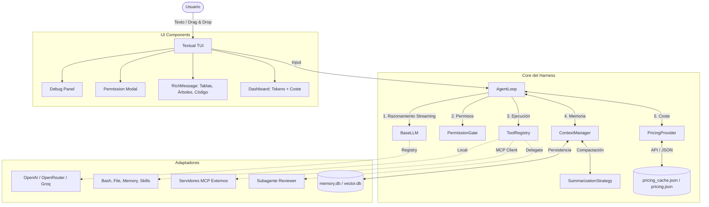
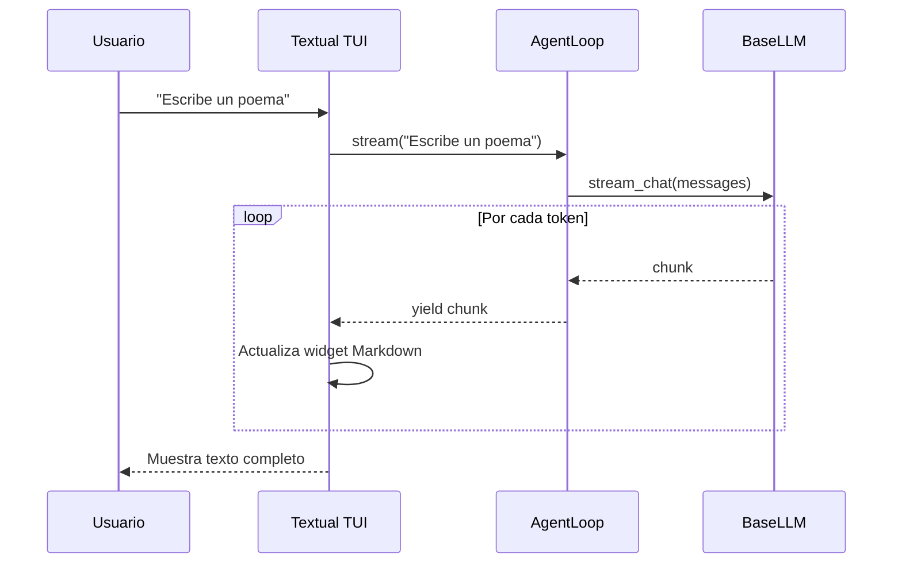

# Arquitectura del Sistema

El Harness está diseñado con un enfoque de **puertos y adaptadores** (Arquitectura Hexagonal). El núcleo (`AgentLoop`) no sabe si el LLM es OpenAI o si las herramientas vienen de un servidor MCP local o remoto.

## Diagrama de Alto Nivel

## Flujo de Ejecución (ReAct Pattern)

