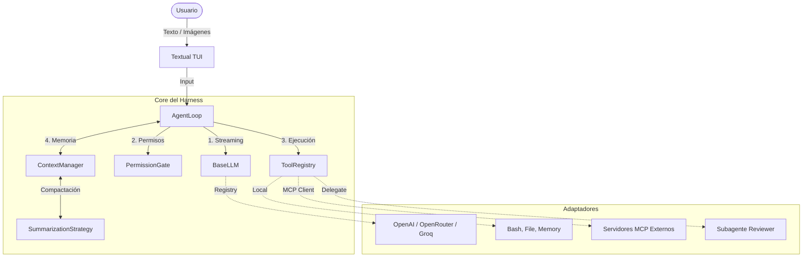

# 🤖 Agent Harness: Multi-Tool, MCP, Subagents & TUI

[](https://codecov.io/github/enriquehernandez/agent-harness)

  
 

 


Un **Agent Harness** de nivel producción construido desde cero. Este proyecto no es solo un "chatbot con herramientas"; es un motor de ejecución que gestiona el ciclo de vida completo de un agente autónomo: razonamiento, ejecución de herramientas locales y remotas (**MCP**), delegación a **subagentes**, multimodalidad (**imágenes**), gestión de permisos con **diff-first**, streaming en tiempo real y una interfaz de terminal (**TUI**) moderna construida con Textual.

Diseñado para ser **100% agnóstico al proveedor de IA**, altamente extensible y con **cobertura de tests del 100%**.

## ✨ Características Principales

- **🧠 LLM Agnóstico (Registry Pattern):** Conecta OpenAI, OpenRouter o Groq modificando una sola variable de entorno.
- **🛠️ Tool Calling Local & Remoto (MCP):** Herramientas locales (`bash`, `read_file`) e integración nativa con el **Model Context Protocol**.
- **🤖 Subagentes Delegados:** El agente principal puede delegar tareas complejas a subagentes aislados con sus propias herramientas.
- **🛡️ Permission Gate con Diff-First:** Interfaz visual que muestra un *diff* de los cambios propuestos antes de aprobar.
- **🔄 Context Compaction (Estrategias):** Tres estrategias (`summarize`, `sliding`, `none`) para mantener la conversación viva sin exceder el límite de tokens.
- **💾 Memoria Persistente:** El agente puede guardar y recuperar hechos importantes del proyecto (`summary.md`).
- **🚀 Streaming en Tiempo Real:** Las respuestas del agente se renderizan token por token en la TUI.
- **🖼️ Multimodalidad:** Soporte para arrastrar y pegar imágenes (codificadas en Base64) que el LLM puede analizar.
- **💻 TUI con Textual:** Una interfaz moderna con temas oscuros, autocompletado, *modales* interactivos, panel de debug (F1) y barra de adjuntos.
- **🧪 100% de Cobertura:** Suite de tests robusta con `pytest` y `textual.pilot`.
- **💰 Telemetría de Costes:** Calcula el coste real en USD de cada llamada usando la API del proveedor (OpenRouter) o un JSON manual (OpenAI/Groq). Caché configurable por `.env`.
- **🔍 Búsqueda Semántica:** Backend de memoria vectorial (`sqlite-vec` + `fastembed`). Encuentra recuerdos por significado, no por palabra exacta.
- **🎨 Renderizado Rico:** La TUI renderiza tablas, árboles y bloques de código con Rich, no solo Markdown.
- **🛡️ MCP Resiliente:** Reconexión automática con backoff exponencial si un servidor MCP cae.

### 📦 Skills (Habilidades)
El Harness puede cargar **skills** desde `.agents/skills/`. Son manuales en Markdown
(`SKILL.md`) que le enseñan al agente a realizar tareas complejas (ej. auditar la
arquitectura, generar reportes HTML, etc.).

- **Descubrimiento automático:** El agente detecta las skills al arrancar.
- **Carga con `@`:** Escribe `@nombre-de-skill` en el input para cargarla.
- **Autocompletado:** Presiona `Tab` después de `@` para ver las skills disponibles.

**Ejemplo:**
```text
🐚 > @improve-codebase-architecture ¿Cómo está la arquitectura de mi proyecto?
```

### 💾 Memoria Persistente (SQLite + Vectores)

El agente recuerda hechos importantes entre sesiones. Backends soportados:

- **`sqlite`** (por defecto): FTS5 para búsqueda por palabras.
- **`vector`**: Búsqueda semántica usando `sqlite-vec` + `fastembed`. Guarda en `.harness/vector.db`.
- **`files`**: Archivos Markdown legibles por humanos.
- **`memory`**: RAM (se pierde al reiniciar).
- **`fanout`**: Escribe en archivos y SQLite a la vez.

### 📁 Sesiones Guardadas
El Harness guarda el historial completo de cada conversación en `.harness/sessions/`
como archivos JSON. Al reiniciar la TUI, **carga automáticamente la última sesión**.

Comandos: `/session list`, `/session load <id>`, `/session save`, `/session delete <id>`.

### 💰 Pricing y Costes

El coste se calcula por llamada y se acumula en la sesión. Comandos:

- `/cost`: Muestra el coste de la última llamada y el total acumulado.
- `pricing_config.json`: Define qué fuente usa cada proveedor (API para OpenRouter, JSON para OpenAI/Groq).
- `pricing.json`: Precios manuales para proveedores sin API pública.
- `PRICING_CACHE_TTL_DAYS`: Días que dura la caché de precios (por defecto 1).

## 🏗️ Arquitectura

El Harness sigue una arquitectura hexagonal donde el núcleo (`AgentLoop`) está completamente desacoplado de los proveedores de IA y de las herramientas.



*📐 Documentación Profunda: Para entender el diseño de cada componente (Agent Loop, Permission Gate, MCP) y las decisiones de arquitectura, consulta el Product Blueprint.*

## 🛠️ Stack Tecnológico

- **Lenguaje**: Python 3.11+
- **Gestión de paquetes**: `uv` (ultrarrápido y reproducible)
- **Integración IA**: `openai` SDK (compatible con OpenRouter/Groq)
- **Protocolo de Herramientas**: `mcp` (Model Context Protocol)
- **Interfaz de Terminal**: `textual`, `rich`
- **Memoria Vectorial**: `sqlite-vec`, `fastembed`
- **Resiliencia**: `tenacity`
- **Testing**: `pytest`, `pytest-asyncio`, `pytest-cov`
- **Contenedores**: Docker, Docker Compose

## 🚀 Quick Start

1. Clonar e instalar dependencias:

```bash
git clone https://github.com/enriquehernandez/agent-harness.git
cd agent-harness
uv sync
```

2. Configurar variables de entorno:

Copia el archivo de ejemplo y configura tu proveedor de IA (por defecto usa `fake` para pruebas locales sin coste):

```bash
cp .env.example .env
```

Edita el `.env`:

```env
# Puedes usar OPENAI, OPENROUTER, GROQ o FAKE
LLM_PROVIDER=OPENROUTER
OPENROUTER_API_KEY=sk-or-v1-tu_api_key_aqui
OPENROUTER_MODEL=openai/gpt-4o
```

3. Levantar la TUI:

```bash
uv run tom dev
# o
uv run python -m app.main
```

## 🐳 Docker
Si prefieres no instalar dependencias locales, puedes usar Docker:

```bash
docker compose build
docker compose run --rm agent-harness
```

## 💻 Uso de la TUI

Una vez dentro del Harness, puedes interactuar con el agente o usar los comandos del sistema:

```text
🤖 Agent Harness iniciado.
Escribe /help para ver los comandos.

🐚 > /help
Comandos disponibles:
  /help          Muestra esta ayuda
  /model         Muestra o cambia el LLM actual
  /tools         Lista las herramientas disponibles
  /subagents     Lista los subagentes registrados
  /compact       Fuerza la compactación (sliding/summarize/none)
  /debug         Controla el panel de debug (on/off/clear)
  /permissions   Gestiona permisos guardados
  /export        Exporta la conversación (markdown/json)
  /quit          Sale del programa

🐚 > ¿Qué ves en esta imagen?
[Arrastra una imagen a la terminal]
🖼️ Imagen adjunta: rejected_invoice.png
🤖 Agente: Veo una factura comercial con un sello de "RECHAZADO"...
```

## 🛡️ El Guardián de Seguridad (Permission Gate)

Si el agente intenta ejecutar una herramienta sensible, el Harness pausará la ejecución y te mostrará un panel interactivo con los argumentos y, si aplica, un **diff de los cambios**:

```text
🛠️  El agente quiere usar: edit_file
╭───────────────────────────────────────────────╮
│ path: app/core/config.py                      │
│                                               │
│ Propuesta de cambios:                         │
│ --- a/app/core/config.py                      │
│ +++ b/app/core/config.py                      │
│ -  LOG_LEVEL: str = "INFO"                    │
│ +  LOG_LEVEL: str = "DEBUG"                   │
╰───────────────────────────────────────────────╯
¿Permitir ejecución? [y/n/a] (n): 
```

- y: Permitir una vez.
- a: Permitir siempre en esta sesión.
- n: Denegar (el agente recibirá un mensaje de error y buscará otra forma).

## 🔌 Integración con MCP (Model Context Protocol)

El Harness puede conectarse a cualquier servidor MCP. El archivo `mcp_config.json` permite definir los servidores externos:

```json
{
  "mcpServers": {
    "filesystem": {
      "command": "npx",
      "args": ["-y", "@modelcontextprotocol/server-filesystem", "/ruta/al/proyecto"]
    }
  }
}
```

Al arrancar la TUI, el agente descubrirá e integrará automáticamente las herramientas expuestas por el servidor.

## 🧪 Testing y Calidad

El proyecto cuenta con una suite de pruebas robusta. Para evitar el consumo de tokens y la dependencia de red, se utiliza un `FakeLLM` inyectable.

```bash
# Ejecutar todos los tests con cobertura
uv run pytest tests/ --cov=app --cov-report=term-missing

# Ejecutar todos los tests con cobertura
uv run tom test
```

🧑‍💻 Autor
Enrique Hernández Leiva
* [LinkedIn](https://www.linkedin.com/in/enrique-hernandez-leiva/)
* [GitHub](https://github.com/enriquehernandez)

