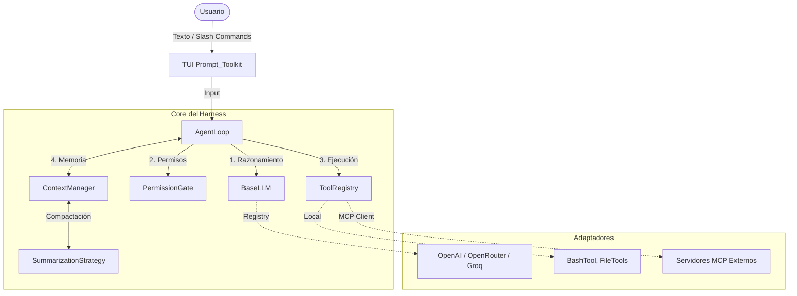

# 🤖 Agent Harness: Multi-Tool, MCP & Permissions

[](https://python.org) [](https://modelcontextprotocol.io) [](LICENSE)

Un **Agent Harness** de nivel producción construido desde cero. Este proyecto no es solo un "chatbot con herramientas"; es un motor de ejecución (Harness) que gestiona el ciclo de vida completo de un agente autónomo: razonamiento, ejecución de herramientas locales y remotas (**MCP**), control de permisos en tiempo real y gestión de memoria a largo plazo.

Diseñado para ser **100% agnóstico al proveedor de IA** y altamente extensible mediante patrones de diseño como *Registry*, *Strategy* y *Factory*.

## ✨ Características Principales

- **🧠 LLM Agnóstico (Registry Pattern):** Conecta OpenAI, OpenRouter, Groq o modelos locales con una sola línea de configuración. Sin código duplicado.
- **🛠️ Tool Calling Local & Remoto (MCP):** Herramientas locales (`bash`, `read_file`, `write_file`) e integración nativa con el **Model Context Protocol (MCP)** para descubrir herramientas externas dinámicamente.
- **🛡️ Permission Gate Interactivo:** El agente no puede ejecutar comandos destructivos sin tu aprobación. Interfaz en consola para aprobar (`y`), denegar (`n`) o recordar (`a`) permisos durante la sesión.
- **🔄 Context Compaction (Auto-Resumen):** Cuando el historial de la conversación supera el 80% de la ventana de contexto, el Harness resume los mensajes antiguos automáticamente, manteniendo la sesión viva sin errores de tokens.
- **💻 TUI (Terminal User Interface):** Una interfaz de línea de comandos moderna construida con `prompt_toolkit` y `rich`. Incluye historial de comandos, autocompletado y *Slash Commands* (`/help`, `/model`, `/compact`, `/tokens`).
- **🧪 100% Testeable (FakeLLM):** Incluye un `FakeLLM` para simular conversaciones y cadenas de herramientas sin gastar tokens ni depender de la red.

## 🏗️ Arquitectura

El Harness sigue una arquitectura hexagonal (puertos y adaptadores) donde el núcleo (`AgentLoop`) está completamente desacoplado de los proveedores de IA y de las herramientas.



*📐 Documentación Profunda: Para entender el diseño de cada componente (Agent Loop, Permission Gate, MCP) y las decisiones de arquitectura, consulta el Product Blueprint.*

## 🛠️ Stack Tecnológico

- **Lenguaje**: Python 3.11+
- **Gestión de paquetes**: `uv` (ultrarrápido y reproducible)
- **Integración IA**: `openai` SDK (compatible con OpenRouter/Groq)
- **Protocolo de Herramientas**: `mcp` (Model Context Protocol)
- **Interfaz de Terminal**: `prompt_toolkit`, `rich`
- **Testing**: `pytest`, `pytest-asyncio`

## 🚀 Quick Start

1. Clonar e instalar dependencias:

```bash
git clone https://github.com/enriquehernandez/agent-harness.git
cd agent-harness
uv sync
```

2. Configurar variables de entorno:

Copia el archivo de ejemplo y configura tu proveedor de IA (por defecto usa `fake` para pruebas locales sin coste):

```bash
cp .env.example .env
```

Edita el `.env`:

```env
# Puedes usar OPENAI, OPENROUTER, GROQ o FAKE
LLM_PROVIDER=OPENROUTER
OPENROUTER_API_KEY=sk-or-v1-tu_api_key_aqui
OPENROUTER_MODEL=openai/gpt-4o
```

3. Levantar la TUI:

```bash
uv run tom dev
# o
uv run python -m app.main
```

## 💻 Uso de la TUI

Una vez dentro del Harness, puedes interactuar con el agente o usar los comandos del sistema:

```text
🤖 Agent Harness iniciado.
Escribe /help para ver los comandos disponibles.

🐚 > /help
Comandos disponibles:
  /help      Muestra esta ayuda
  /model     Muestra o cambia el LLM actual (ej. /model fake)
  /tokens    Muestra el uso estimado de tokens de la sesión
  /compact   Fuerza la compactación del contexto (resumen)
  /clear     Limpia el historial de conversación
  /quit      Sale del programa

🐚 > ¿Qué archivos hay en este proyecto?
🤖 Agente: He encontrado los siguientes archivos...
[dim]Pasos: 2 | Tools: ['bash'] | Tokens API: 145[/dim]
```

## 🛡️ El Guardián de Seguridad (Permission Gate)

Si el agente intenta ejecutar una herramienta sensible (como `bash`), el Harness pausará la ejecución y te pedirá permiso:

```text
🛠️  El agente quiere usar: bash
╭───────────────────────────────────────────────╮
│ command: ls -la                               │
╰───────────────────────────────────────────────╯
¿Permitir ejecución? [y/n/a] (n): 
```

- y: Permitir una vez.
- a: Permitir siempre en esta sesión.
- n: Denegar (el agente recibirá un mensaje de error y buscará otra forma).

## 🔌 Integración con MCP (Model Context Protocol)

El Harness puede conectarse a cualquier servidor MCP. El archivo `mcp_config.json` permite definir los servidores externos:

```json
{
  "mcpServers": {
    "dummy": {
      "command": "uv",
      "args": ["run", "python", "scripts/dummy_mcp_server.py"]
    }
  }
}
```

Al arrancar la TUI, el agente descubrirá e integrará automáticamente las herramientas expuestas por el servidor.

## 🧪 Testing y Calidad

El proyecto cuenta con una suite de pruebas robusta. Para evitar el consumo de tokens y la dependencia de red, se utiliza un `FakeLLM` inyectable.

```bash
# Ejecutar todos los tests con cobertura
uv run pytest tests/ --cov=app --cov-report=term-missing
```

🧑‍💻 Autor
Enrique Hernández Leiva
* [LinkedIn](https://www.linkedin.com/in/enrique-hernandez-leiva/)
* [GitHub](https://github.com/enriquehernandez)

