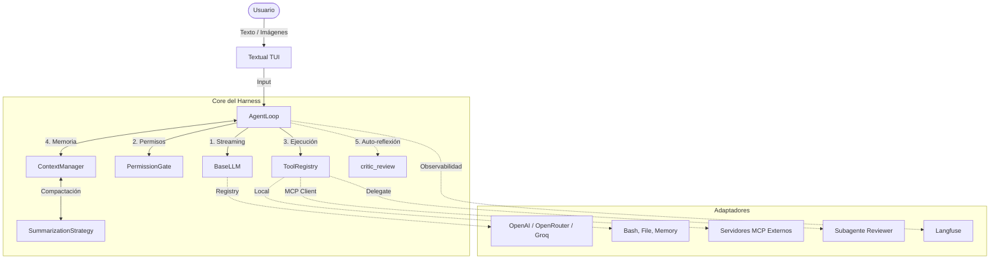

# 🤖 Agent Harness: Multi-Tool, MCP, Subagents & TUI

[](https://codecov.io/github/enriquehernandez/agent-harness)

 
 

 


Un **Agent Harness** de nivel producción construido desde cero. Este proyecto no es solo un "chatbot con herramientas"; es un motor de ejecución que gestiona el ciclo de vida completo de un agente autónomo: razonamiento, ejecución de herramientas locales y remotas (**MCP**), delegación a **subagentes**, multimodalidad (**imágenes**), gestión de permisos con **diff-first**, streaming en tiempo real, auto-reflexión con un crítico, observabilidad con **Langfuse** y una interfaz de terminal (**TUI**) moderna construida con Textual.

Diseñado para ser **100% agnóstico al proveedor de IA**, altamente extensible y con **cobertura de tests del 100%**.

## ✨ Características Principales

- **🧠 LLM Agnóstico (Registry Pattern):** Conecta `openai`, `openrouter` o `groq` modificando una sola variable de entorno. `fake` está disponible para pruebas locales sin coste.
- **🛠️ Tool Calling Local & Remoto (MCP):** Herramientas locales (`bash`, `read_file`, `write_file`, `edit_file`, `read_document`) e integración nativa con el **Model Context Protocol**. Las tools MCP se registran con el prefijo `mcp_<servidor>_` y ejecutan con `TOOL_TIMEOUT` (30 s por defecto).
- **🤖 Subagentes Delegados:** El agente principal puede delegar tareas complejas a subagentes aislados con sus propias herramientas.
- **🛡️ Permission Gate con Diff-First:** Interfaz visual que muestra un *diff* de los cambios propuestos antes de aprobar.
- **🔄 Context Compaction (Estrategias):** Tres estrategias (`summarize`, `sliding`, `none`) para mantener la conversación viva sin exceder el límite de tokens.
- **💾 Memoria Persistente:** Por defecto usa SQLite con FTS5 en `.harness/memory.db`. `summary.md` solo se genera en los backends `files` y `fanout`.
- **🚀 Streaming en Tiempo Real:** `AgentLoop.stream` emite eventos `AgentEvent` (`text_chunk`, `tool_start`, `tool_end`, `result`, `error`) y la TUI renderiza el texto token por token.
- **🖼️ Multimodalidad:** Soporte para arrastrar y pegar imágenes (codificadas en Base64) que el LLM puede analizar.
- **💻 TUI con Textual:** Una interfaz moderna con temas oscuros, autocompletado, *modales* interactivos, panel de debug (F1) y barra de adjuntos.
- **🧪 100% de Cobertura:** Suite de tests robusta con `pytest` y `textual.pilot`.
- **💰 Telemetría de Costes:** Calcula el coste real en USD de cada llamada usando la API del proveedor (OpenRouter) o un JSON manual (OpenAI/Groq). Caché configurable por `.env`.
- **🔍 Búsqueda Semántica:** Backend de memoria vectorial (`sqlite-vec` + `fastembed`). Encuentra recuerdos por significado, no por palabra exacta.
- **🎨 Renderizado Rico:** La TUI renderiza tablas, árboles y bloques de código con Rich, no solo Markdown.
- **🛡️ MCP Resiliente:** Reconexión automática con backoff exponencial si un servidor MCP cae.
- **🤖 Agent-to-Agent (A2A):** Orquestación multi-agente con 4 estrategias (supervisor, sequential, parallel, swarm) configurable via `.env`.
- **🖼️ Renderizado de Imágenes:** Las imágenes pegadas/arrastradas se muestran en el chat con `HalfcellImage` si `TERM_PROGRAM=WarpTerminal`, y con `TerminalImage` en el resto de terminales.
- **📄 Lectura de Documentos:** `read_document` extrae texto de `.pdf`, `.docx`, `.xlsx` y `.pptx`, y también de los formatos antiguos `.doc`, `.xls` y `.ppt` (estos últimos con `olefile`/`xlrd`, de forma best-effort), con un límite de `MAX_DOCUMENT_CHARS=15000`.
- **🪞 Auto-Reflexión con Crítico:** La tool `critic_review` revisa la respuesta propuesta contra las reglas del proyecto y puede forzar hasta 2 reintentos, inyectando el feedback del crítico en el contexto. Usa `A2A_REVIEWER_MODEL` como modelo del crítico si está configurado.
- **🔬 Observabilidad con Langfuse:** Si hay `LANGFUSE_PUBLIC_KEY` y `LANGFUSE_SECRET_KEY`, cada stream se registra como una generación con su entrada, uso de tokens y coste.
- **📂 Rutas Centralizadas:** `DATA_DIR` (por defecto `.harness`) es la raíz de `memory.db`, `vector.db`, `permissions.json`, `logs/` (con el log diario `yyyy_MM_dd_harness.log`), `sessions/` y `pricing_cache.json`.
- **💡 Skill `token-budget-guard`:** Primera skill vendible del proyecto: analiza el consumo de tokens y costes por sesión/modelo, avisa al superar presupuestos y sugiere modelos más baratos o prompt caching.


### 📦 Skills (Habilidades)
El Harness puede cargar **skills** desde `.agents/skills/`. Son manuales en Markdown
(`SKILL.md`) que le enseñan al agente a realizar tareas complejas (ej. auditar la
arquitectura, generar reportes HTML, etc.).

- **Descubrimiento automático:** El agente detecta las skills al arrancar.
- **Carga con `@`:** Escribe `@nombre-de-skill` en el input para cargarla.
- **Autocompletado:** Tras escribir `@`, la sugerencia se acepta con la **flecha derecha**.
- **`token-budget-guard`:** Incluida en el repositorio como primera skill vendible; se invoca con `@token-budget-guard` y guarda sus informes en `.harness/token-budget-guard/reports/`.

**Ejemplo:**
```text
🐚 > @improve-codebase-architecture ¿Cómo está la arquitectura de mi proyecto?
```

### 💾 Memoria Persistente (SQLite + Vectores)

El agente recuerda hechos importantes entre sesiones. Backends soportados:

- **`sqlite`** (por defecto): FTS5 en `DATA_DIR/memory.db` (`.harness/memory.db` con el `DATA_DIR` por defecto).
- **`vector`**: Búsqueda semántica usando `sqlite-vec` + `fastembed`. Guarda en `DATA_DIR/vector.db` (`.harness/vector.db`).
- **`files`**: Archivos Markdown legibles por humanos en `DATA_DIR/memory/`; mantiene un `summary.md` agregado.
- **`memory`**: RAM (se pierde al reiniciar).
- **`fanout`**: Escribe en archivos y SQLite a la vez; también genera `summary.md` en la parte de archivos.

Todas estas rutas cuelgan de `DATA_DIR`, configurable en `.env`.

### 📁 Sesiones Guardadas
El Harness guarda el historial completo de cada conversación en `DATA_DIR/sessions/` (`.harness/sessions/` por defecto)
como archivos JSON. Al reiniciar la TUI, **carga automáticamente la última sesión**.

Comandos: `/session list`, `/session load <id>`, `/session save`, `/session delete <id>`, `/session new`.

### 💰 Pricing y Costes

El coste se calcula por llamada y se acumula en la sesión. Comandos:

- `/cost`: Muestra el coste de la última llamada y el total acumulado.
- `pricing_config.json`: Define qué fuente usa cada proveedor (API para OpenRouter, JSON para OpenAI/Groq).
- `pricing.json`: Precios manuales para proveedores sin API pública.
- `PRICING_CACHE_TTL_DAYS`: Días que dura la caché de precios (por defecto 1).

## 🏗️ Arquitectura

El Harness sigue una arquitectura hexagonal donde el núcleo (`AgentLoop`) está completamente desacoplado de los proveedores de IA y de las herramientas.



*📐 Documentación Profunda: Para entender el diseño de cada componente (Agent Loop, Permission Gate, MCP) y las decisiones de arquitectura, consulta el Product Blueprint.*

## 🛠️ Stack Tecnológico

- **Lenguaje**: Python 3.11–3.12 (`>=3.11,<3.13`)
- **Gestión de paquetes**: `uv` (ultrarrápido y reproducible)
- **Integración IA**: `openai` SDK (compatible con OpenRouter/Groq)
- **Protocolo de Herramientas**: `mcp` (Model Context Protocol)
- **Interfaz de Terminal**: `textual` (>=8.2.8), `rich`, `textual-image`
- **Orquestación**: `AgentLoop` + A2A (Supervisor, Sequential, Parallel, Swarm)
- **Memoria Vectorial**: `sqlite-vec`, `fastembed`
- **Observabilidad**: `langfuse`
- **Resiliencia**: `tenacity`
- **Testing**: `pytest`, `pytest-asyncio`, `pytest-cov`
- **Contenedores**: Docker, Docker Compose
- **Document Parsing**: `pypdf`, `python-docx`, `openpyxl`, `python-pptx`

## 🚀 Quick Start

1. Clonar e instalar dependencias:

```bash
git clone https://github.com/enriquehernandez/agent-harness.git
cd agent-harness
uv sync
```

2. Configurar variables de entorno:

Copia el archivo de ejemplo. El proveedor por defecto es `fake`, tanto en `app/core/config.py` como en `.env.example`, así que la TUI arranca sin API key. Para usar un proveedor real, cambia `LLM_PROVIDER` y añade su clave:

```bash
cp .env.example .env
```

Edita el `.env`:

```env
# Puedes usar openai, openrouter, groq o fake; `fake` no necesita API key
LLM_PROVIDER=fake

# Para usar OpenRouter, cambia lo anterior y rellena la key:
# LLM_PROVIDER=openrouter
# OPENROUTER_API_KEY=sk-or-v1-tu_api_key_aqui
# OPENROUTER_MODEL=openai/gpt-4o
```

3. Levantar la TUI:

```bash
uv run tom dev
# o
uv run python -m app.main
```

## 🐳 Docker
Si prefieres no instalar dependencias locales, puedes usar Docker:

```bash
docker compose build
docker compose run --rm agent-harness
```

## 💻 Uso de la TUI

Una vez dentro del Harness, puedes interactuar con el agente o usar los comandos del sistema:

```text
🤖 Agent Harness iniciado.
Escribe /help para ver los comandos.

🐚 > /help
Comandos disponibles:
  /help                  Muestra esta ayuda
  /shortcuts             Muestra los atajos de teclado (alias: /hotkeys)
  /model [nombre]        Muestra o cambia el LLM actual
  /provider [nombre]     Muestra o cambia el proveedor (openai/openrouter/groq/fake)
  /tools                 Lista las herramientas disponibles en el Registry
  /subagents             Lista los subagentes registrados
  /skills                Lista tools, subagentes y skills instaladas
  /tokens                Muestra el uso estimado de tokens
  /cost                  Muestra el coste real (USD) de la última llamada
  /compact [estrategia]  Fuerza la compactación (sliding/summarize/none)
  /verbose [on/off]      Muestra/oculta los detalles de la compactación
  /clear                 Limpia el historial de conversación
  /debug [on/off/clear]  Controla el panel de debug
  /permissions           Gestiona permisos guardados
  /export [formato]      Exporta la conversación (markdown/json)
  /memory [clear/migrate [backend]]      Gestiona la memoria persistente
  /session [list/load/delete/save/new]   Gestiona las sesiones guardadas
  /doctor                🩺 Diagnóstico del estado del sistema
  /trace                 📊 Muestra el uso real de tokens de la última llamada
  /quit                  Sale del programa (alias: /exit)

  Códigos de respuesta (solo la pregunta siguiente):
  /truth                 Sin cortesía; crítica honesta y fallas
  /human                 Tono natural y cercano
  /nofluff               Sin saludos, rodeos ni relleno
  /devil                 Abogado del diablo; busca puntos débiles
  /decode                Traduce lenguaje técnico o legal
  /genius                Muestra pasos verificables antes de concluir

🐚 > ¿Qué ves en esta imagen?
[Arrastra una imagen a la terminal]
🖼️ Imagen adjunta: rejected_invoice.png
🤖 Agente: Veo una factura comercial con un sello de "RECHAZADO"...
```

`/session new` guarda la sesión actual y crea una nueva; `/memory migrate sqlite` cambia el backend de memoria; `/reload [skills|permissions|tools]` recarga las skills, los permisos persistidos o las herramientas y conexiones MCP (conservando el contexto).

Los códigos de respuesta cambian solo el estilo de la siguiente pregunta y se consumen automáticamente: escribe `/devil` y luego tu pregunta, o `/devil ¿Qué fallos tiene este plan?` en una sola línea. No hay que desactivarlos; la pregunta siguiente vuelve al tono normal. No modifican las reglas de `AGENTS.md` ni los permisos.

## 🪝 Hooks del ciclo de vida

Puedes ejecutar tus propios comandos cuando ocurre un evento (envío de un prompt, antes y después de usar una herramienta, antes y después de compactar, fin del turno). Se configuran una vez en `.harness/hooks.json` y se disparan solos; no hay que escribir ningún comando en la TUI:

```json
{
  "hooks": {
    "PreToolUse": [
      {
        "matcher": "bash",
        "hooks": [{ "type": "command", "command": "python3 .harness/hooks/no_delete.py" }]
      }
    ],
    "PostToolUse": [
      {
        "matcher": "edit_file|write_file",
        "hooks": [{ "type": "command", "command": "python3 .harness/hooks/audit.py" }]
      }
    ]
  }
}
```

Los hooks `command` reciben el evento como JSON por stdin con timeout de `TOOL_TIMEOUT`; también hay hooks `http`, `prompt` y `agent`. `matcher` acepta nombres, alternativas y regex, y `if` filtra por firma `herramienta:detalle`. `/hooks` lista la configuración activa y sus errores; `/hooks reload` la recarga (también se recarga sola si cambia el archivo). Los hooks incluidos hacen dos cosas: `audit.py` centraliza el registro en `.harness/hooks/audit.log` (ediciones y bloqueos), y `no_delete.py` importa su función `log_event()` para dejar constancia del borrado intentado antes de devolver el `deny`. Cuando un hook devuelve `deny` (JSON con `hookSpecificOutput.permissionDecision`, o código 2 con el motivo en stderr), la herramienta **no se ejecuta** y el chat muestra `🚫 Bloqueado por un hook` con el motivo, aunque los permisos la hubieran permitido. Si el hook falla o devuelve una salida no válida, el agente sigue (fail-open). `decision: block` en `Stop` o `PostToolUse` añade un mensaje de feedback al contexto y, en `Stop`, hace que el agente siga iterando en lugar de cerrar el turno. Los hooks de `UserPromptSubmit` corren en paralelo después de mostrar tu mensaje, para que un hook lento no retrase la respuesta visual. Con F1 (panel de debug) puedes ver el ciclo de vida de cada hook: evento, tipo, matcher, entrada, salida, estado y duración; al pulsar una entrada se abre el detalle JSON. `additionalContext` se concatena entre hooks en `UserPromptSubmit`/`PreToolUse`/`PostToolUse`, se muestra al modelo como un mensaje temporal antes de cada llamada al LLM y se retira al terminar el turno (nunca se guarda en la sesión). `disableAllHooks: true` los apaga todos. Ver `PRODUCT_BLUEPRINT/02_COMPONENTS/11_hooks.md`.

## 🛡️ El Guardián de Seguridad (Permission Gate)

Si el agente intenta ejecutar una herramienta sensible, el Harness pausará la ejecución y te mostrará un panel interactivo con los argumentos y, si aplica, un **diff de los cambios**:

```text
🛠️  El agente quiere usar: write_file
╭───────────────────────────────────────────────╮
│ path: app/core/config.py                      │
│                                               │
│ Propuesta de cambios:                         │
│ --- a/app/core/config.py                      │
│ +++ b/app/core/config.py                      │
│ -  LOG_LEVEL: str = "INFO"                    │
│ +  LOG_LEVEL: str = "DEBUG"                   │
╰───────────────────────────────────────────────╯
¿Permitir ejecución? [y/n/a] (n): 
```

- y: Permitir una vez.
- a: Permitir siempre: guarda la firma de la tool en `.harness/permissions.json` (o `DATA_DIR/permissions.json`) y **persiste entre sesiones**, no solo durante la sesión actual.
- n: Denegar (el agente recibirá un mensaje de error y buscará otra forma).

## 🔌 Integración con MCP (Model Context Protocol)

El Harness puede conectarse a cualquier servidor MCP. El archivo `mcp_config.json` permite definir los servidores externos:

```json
{
  "mcpServers": {
    "filesystem": {
      "command": "npx",
      "args": ["-y", "@modelcontextprotocol/server-filesystem", "/ruta/al/proyecto"]
    }
  }
}
```

Al arrancar la TUI, el agente descubrirá e integrará automáticamente las herramientas expuestas por el servidor, con nombres `mcp_<servidor>_<tool>`. Cada llamada remota usa `TOOL_TIMEOUT` (30 s por defecto) y, si el servidor cae, se reconecta con backoff exponencial.

## 🧪 Testing y Calidad

El proyecto cuenta con una suite de pruebas robusta. Para evitar el consumo de tokens y la dependencia de red, se utiliza un `FakeLLM` inyectable.

```bash
# Ejecutar tests unitarios con cobertura. OJO: `addopts` en pyproject.toml
# incluye --ignore=tests/integration, así que NO incluye los tests de integración.
uv run pytest tests/ --cov=app --cov-report=term-missing

# Equivalente: tampoco incluye tests/integration
uv run tom test

# Tests de integración (los excluidos arriba):
uv run tom test-integration
```

🧑‍💻 Autor
Enrique Hernández Leiva
* [LinkedIn](https://www.linkedin.com/in/enrique-hernandez-leiva/)
* [GitHub](https://github.com/enriquehernandez)
