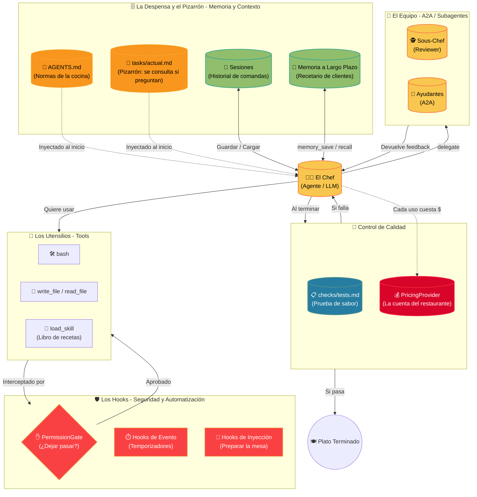

# 🍳 La Analogía de la Cocina: Entendiendo el Agent Harness

Para entender cómo funciona este proyecto, imagina que el **Harness es una cocina profesional de alto rendimiento**. Cada componente del código tiene un equivalente exacto en el mundo de la gastronomía.

# 🗺️ Mapa Visual: La Cocina del Agent Harness

## 🧑‍🍳 El Equipo de Cocina (Los Agentes)

*   **El Chef Principal (El Agente / LLM):** Es el cerebro. Toma las decisiones, lee las órdenes, decide qué cocinar y en qué orden. No sabe todo de memoria, pero sabe cómo buscar y usar lo que tiene.
*   **El Sous-Chef (Subagente Reviewer):** El chef principal le pasa un plato y le dice: *"Prueba esto y dime si le falta sal"*. Es tu herramienta `delegate_to_reviewer`.
*   **Los Ayudantes (Sistema A2A - Agent-to-Agent):** Cuando hay mucho trabajo, el chef delega. *"Tú pela las papas, tú corta la cebolla"*. Dependiendo de la estrategia (`sequential`, `parallel`, `swarm`), los ayudantes trabajan en línea o al mismo tiempo.

## 🏗️ La Infraestructura (El Entorno)

*   **La Cocina (El Harness):** La infraestructura física. Los fogones (el motor del LLM), la despensa (la base de datos) y el espacio de trabajo.
*   **Los Utensilios (Las Tools):** Cuchillos, licuadoras, hornos. Son las herramientas (`bash`, `write_file`, `read_text_file`). El chef las usa para manipular los ingredientes. No puede cocinar sin ellas.
*   **Las Comandas Guardadas (Las Sesiones / `SessionManager`):** Cada vez que el restaurante cierra, se guardan las comandas en un libro (archivos JSON). Al día siguiente, el chef lee la última comanda y sabe exactamente en qué mesa se quedó trabajando.

## 📖 Las Instrucciones (La Información)

*   **Las Recetas (Los Skills / `.md`):** El chef no memoriza cómo hacer un Soufflé. Cuando le piden uno, lee la receta (`load_skill` o `@nombre-skill`) y ejecuta los pasos exactos.
*   **La Despensa y el Pizarrón:** 
    *   `AGENTS.md`: Las normas de la cocina ("Los cuchillos se afilan así").
    *   `tasks/actual.md`: El pizarrón de tareas; el chef solo lo consulta si el cliente pregunta por el estado, no lo menciona a cada comanda.
    *   **Memoria:** El recetario de gustos de los clientes (ej. "El cliente 1 prefiere la carne sin sal").

## 🛡️ Los Hooks: El "Chef Supervisor"

En una cocina real, no basta con que el chef sepa usar los utensilios; necesitas a alguien (o algo) que supervise, automatice y ponga límites. **Los Hooks son ese "Chef Supervisor" invisible.**

*   **El Temporizador (Hooks de Evento):** El chef mete el pastel al horno. Un hook se dispara: *"A los 20 minutos, haz sonar la campana para sacarlo"*. En tu código, es ese mecanismo que se ejecuta automáticamente cuando una herramienta termina (por ejemplo, guardar un log o hacer una limpieza).
*   **La Regla de Seguridad (Hook de Intercepción - PermissionGate):** Si el chef intenta meter la mano en el horno a 200°C, el supervisor lo detiene: *"¡Alto! Necesito autorización de la gerencia (el humano) para abrir el horno"* (`y/a/n`). Este es tu sistema de permisos que bloquea acciones peligrosas como `bash` o `write_file`.
*   **La Preparación Previa (Hook de Inyección):** Antes de que el chef empiece a cocinar, el supervisor le pone en la mesa los ingredientes exactos. En tu código, es el hook que intercepta el comando `capture_snapshot.py` y le inyecta automáticamente `--tools observations.json` para que la receta funcione bien desde el principio.

## 💰 El Dueño del Restaurante (Los Costos / PricingProvider)

Cocinar no es gratis. Cada vez que el chef usa un ingrediente importado (un LLM caro), gasta dinero. 
El `PricingProvider` es el **Dueño del Restaurante**. Lleva la cuenta exacta de cuánto cuesta cada plato (tokens de entrada y salida). Si el chef usa un modelo muy caro (como GPT-4o) o un modelo barato (como Groq), el dueño sabe exactamente cuánto descontar de la caja registradora (`/cost`).

## 🛡️ El Control de Calidad

*   **Las Normas de Sanidad (Los Checks / Tests):** El chef no puede decir "Plato terminado" si no ha pasado por la prueba de sabor (tests unitarios). Si la comida no cumple con el estándar de calidad (`checks/tests.md` y cobertura 100%), se tira a la basura y se vuelve a empezar.

---

## 💡 ¿Cómo usar esta analogía al desarrollar?

Cuando algo falle en el Harness, pregúntate:
1.  *¿El chef está leyendo la receta equivocada?* ➡️ Problema de Skill.
2.  *¿El chef no tiene el cuchillo adecuado?* ➡️ Problema de Tool/Registry.
3.  *¿El supervisor se quedó dormido y no frenó al chef?* ➡️ Problema de Hook/PermissionGate.
4.  *¿La cocina está tan llena de humo que el chef no ve?* ➡️ Problema de ventana de contexto (Demasiados tokens).
5.  *¿Nos quedamos sin presupuesto a mitad del servicio?* ➡️ Problema de Pricing/Token usage.